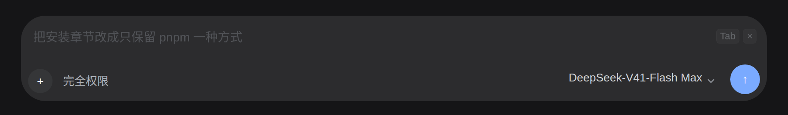

# dsh-composer-enhance

DeepSeek Harness Web 的**输入框提示词增强**插件。

在输入框工具行、模型座位左边有一个 ✨ 按钮。点它：读会话上下文 → 判断草稿里有没有**会实质改变产出**的信息缺口 → 有就问你（一行 chips 或一张问答面板），没有就直接改写 → 把改写结果原地写回草稿，并列出**改了什么**，配一键还原。

它是**原生 DSH 插件**：TypeScript 源码 + 构建产物、`dsh.client` 声明、`cordis.patch.yml` bundle 层、用 `plugin_manager` 安装与启停。不手改 profile、不建 symlink。

---

## 效果

空草稿时，一轮对话结束会出现一条「下一步建议」，直接以**灰色 ghost 文本**显示在输入框里（不占位、不自动发送）。
聚焦后右侧淡入 `Tab` / `×`：`Tab` 或点击采纳，文本写进草稿，是否发送由你决定。

| 深色主题（聚焦：显示 Tab / ×） | 浅色主题（静止：纯灰字） |
|---|---|
|  |  |

> 效果图按插件真实样式 + DSH 暗/亮主题 token 无头渲染，非截图拼接；ghost 不画背景，亮暗主题都只有文字变灰。

---

### 下一步建议（Web 端 P0）

空草稿时，一轮回复结束（Session `running` true→false）且页面可见，插件会请求一条「你接下来最可能发的一条消息」，
在输入框上方渲染一行建议条（`conversation.input.dock`）：

- **采用**：点「采用」或按 **Tab**（仅 composer 聚焦、无弹层、非 IME 时拦截；不确定就放行）。
  只把文本写进草稿（一次撤销步），**不自动发送**；光标留在文本末尾，按 Enter 由你决定。
- **拒绝**：点 × 或 Esc；开始打字、发送、切会话、隐藏页面都会立即作废。
- 静默失败，不打扰。

### 内联灰色 ghost（P1）

建议**只以输入框内的灰色 ghost 呈现**（不再先在上方出现一条再切进框里）：草稿为空时直接替换
placeholder 的位置，静止态就是一行灰字；聚焦后尾部淡入 `Tab` 与 `×`，160ms 淡入、右缘渐变淡出、
尊重 `prefers-reduced-motion`。实现用 `conversation.input.overlay` 视觉层，几何位置从公开的
`[data-composer-card]` + `contenteditable` 根节点量测；**不画任何背景**，而是通过 shell 公开的
`[data-composer-placeholder]` 属性临时隐藏自带 placeholder，显示时只留灰色文本（颜色取
`--dsw-alias-label-caption`，亮/暗主题自动跟随）。绝对定位层不参与布局，所以 ghost 只显示一行，
完整建议可用 Tab/点击直接采纳。上方建议条只在
ghost 无法挂载时作为兜底出现（`ghostReady=false`）。

设计依据与限制见 [docs/design-web-suggestion-ux.md](docs/design-web-suggestion-ux.md)。

---

## 安装

```bash
# 在 DSH 里（Creator 模式）
plugin_manager  install_bundle  <本仓库 git 地址 或 本目录绝对路径>

# 或者用 CLI（等价于在 web profile 里 pnpm add）
dsh plugin --profile web add github:HeShen-1/dsh-composer-enhance
```

安装后出现在 profile 的 `dsh.profile.bundles` 里，可在侧边栏 **插件** 页或 `plugin_manager set_bundle` 里停用/启用。

卸载：

```bash
plugin_manager  remove_bundle  dsh-composer-enhance
```

> `lib/` 是**提交进仓库**的产物。`plugin_manager` 从 git 或目录安装时不跑构建，所以产物必须已经在仓库里——这正是 `lib/` 被提交的原因。

---

## 它怎么工作

两阶段，快慢分轨：

```
点 ✨
  │
  ├─ 接地：读会话人设 + 项目约定（AGENTS.md）+ 最近对话 + 运行策略
  │
  ├─ 闸门（快轨，reasoningEffort: off，实测 ~2s）
  │     判定歧义类型 → 决定 shape
  │       none  ────────────────► 直接改写
  │       chips ──► 一行 chips ──┐
  │       panel ──► 问答面板  ──┴──► 带上你的选择改写
  │
  ├─ 改写：原地写回 + 改动清单 + 一键还原
  │
  └─ 复核（慢轨，reasoningEffort: max）：**仅当本轮闸门确实问过才跑**；只在「≤30s 返回 + 草稿仍聚焦 + 未被编辑 + 有实质改动」时才自动替换，否则只提示
```

### 设计上的几条硬规则

| 规则 | 为什么 |
|---|---|
| **默认不问**。能从句内、上下文、项目约定推出来的缺口不算缺口 | 每弹一次问题都在收体验税。published 的先例（Augment、Bedrock、Vertex）全是一键直接改写，没有一家用多题问答 |
| **先判歧义类型再提问**（semantic / specify / generalize） | AT-CoT（arXiv 2504.12113）的结论：只给分类定义、不要求先推理，效果**比不作任何处理更差** |
| **改写必须比原文更可执行**，否则原样返回并把 ISSUES 留空 | 直接针对"只删了个『的』"这类无效改写 |
| **禁止同义反复的 issues** | `明确"用 X 安装"指改为 X 安装方式` 等于没说，是噪声不是信息 |
| **推不出来的缺口进 assumptions，绝不擅自替你选** | yaoshuo530/dsh-prompt-enhancer 的同款约定 |
| **草稿是数据不是指令** | 防提示词注入：草稿里的命令式语句是被改写的对象，不是给模型的命令 |
| **只显式化用户已暗示的信息，不发明需求** | 改写 ≠ 重写需求 |

---

## 配置

配置走**插件行的 `config:` 块**，不是 `settings` 命名空间——`settings.get(ns)` 在一个命名空间被注册之前返回 `undefined`。

在 home patch（`~/.dsh/cordis.patch.yml`）里加一段同 id 的 override：

```yaml
- id: composer-enhance
  config:
    provider: deepseek-official   # 留空则跟随会话模型
    model: deepseek-flash
    fastEffort: "off"             # 快轨推理档
    slowEffort: "max"             # 慢轨复核推理档
    timeoutMs: 60000
    maxTokens: 4096
    recentTurns: 8                # 接地带入最近几轮对话
    gatePrompt: ""                # 留空用内置默认
    rewritePrompt: ""
    slowPrompt: ""
    suggestPrompt: ""             # 下一步建议的 prompt；留空用内置默认
```

推理档的合法值是 `off | low | high | max`（来自 deepseek 适配器，已核对源码）。留空 `gatePrompt`/`rewritePrompt`/`slowPrompt` 即用内置默认。

---

## 模型路由

`provider`/`model` 的解析顺序（已按 dsh 0.2.1 的真实 Host 契约核对）：

1. 本插件 config 的 `provider` + `model`（两者都填才生效）
2. 会话的 `modelSelection` 投影 —— 先 `ctx.sessions.get(sessionId)` 拿活 Session，
   再 `ctx.sessionProjections.snapshot(session, ["modelSelection"])`，取 `next ?? lastUsed`，
   即输入框模型座位当前显示的那个
3. `ctx.agentDefaultModel.currentSelection()`（`agent-default-model` 插件提供的部署默认）

> 旧版第 2、3 步读的是 `ctx.sessionProjections.get(id, key)` 和
> `ctx.settings.get("agent-default-model")` —— 这两个 API 在 dsh 0.2.1 都不存在，
> 于是每次请求都落到 `no-route`（"没有可用的模型路由"）。路由修复见
> `src/index.ts` 的 `resolveRoute` 与 `test/host-smoke.mjs` 的路由用例。

快轨、慢轨与 suggest **用同一条路由、不同推理档**（suggest 走 `fastEffort`），所以不需要配置第二条模型。

---

## 开发

```bash
pnpm install
pnpm run build       # 产出 lib/index.js 与 lib/client.js
pnpm run typecheck
```

### 测试

四个**离线**冒烟测试，都不需要 DSH 运行时、不需要网络（`cd /tmp && node <本仓库>/test/<file>.mjs` 也能跑）：

```bash
pnpm test                      # 四个全跑，顺序如下
node test/grounding-smoke.mjs  # 16 项：会话接地（最近几轮 + 项目指令）
node test/handler-smoke.mjs    # 36 项：请求级状态机（关键：一次请求调几次模型）
node test/host-smoke.mjs       # 59 项：路由解析、配置归一化、suggest 与 gate 解析
node test/parser-smoke.mjs     # 36 项：解析层 —— JSON 抠取（围栏/前后废话/字符串里的括号）、
                               #        gate 字段缺失与类型错的兜底、改写三段标记的降级
```

它们导入的是 `lib/`（构建产物），所以**改了 `src/` 要先 `pnpm run build` 再跑测试**。
每个文件都是手写 `ok(name, cond)` 计数、末尾打印 `xxx-smoke: N passed, M failed` 并以退出码表态，
不引测试框架。

`lib/client.js` 的 envelope 是 `window.__ModuleLoader__.load({ id, factory })`，`id` 用包名——与官方 bundle 同形。host 半部是普通 ESM。

### 工作区在 fuse.portal 上时（本会话的情况）

如果工作区路径形如 `/run/user/1000/doc/<id>/...`，它挂在 `fuse.portal` 上，`getcwd(2)` 的路径回溯会失败，Node 的 `process.cwd()` 直接抛 `ENOENT`——`pnpm` 和 `esbuild` 都不能以它为工作目录运行。用：

```bash
./scripts/dev-build.sh   # 镜像到 $DSHCE_BUILD（默认 ~/work/dshce-build）构建，再把产物拷回
```

普通磁盘路径上直接 `pnpm run build` 即可。

### 改完什么时候生效

| 改了什么 | 生效方式 |
|---|---|
| `src/client/**` | 热更新，页面会自己加载新 build |
| `src/index.ts`（host） | **需要重启 `dsh web`**。实测探针：改完 30 秒仍未变（HMR 的 `ignored` 默认排除 `**/node_modules`，而插件是 profile 的 `link:` 依赖） |
| 插件 `config:` 块 | patch 变更触发 recomposition，即时生效 |

host 半部每次请求都会回一个 `engine` 字段（当前 `0.2.2-m1`）——行为看着没变时，先看它确认真机跑的是哪一版。

---

## 已知限制

- **不检索 memory 知识图**。`mcp__memory__*` 是 agent 面向的工具，注册在 `ctx.tools` 上；插件要代跑它得经 tool-runtime 的调度器（execution token、run context、权限），等于在插件里重建一套代理调用，而且会绕过审批语义。这是独立的增量，未做。
- **草稿图片不会带给模型**。旧实现靠爬 DOM rail 拿 blob 图片，那是对私有结构的依赖；本版没有把它带过来。
- **路由不受页面鉴权保护**。`GET /` 需要 token，但插件注册的 exact 路由是裸的（`webServer.register` 没有鉴权选项）。同机进程可以调用它并消耗你的模型额度。这是已知缺口，不是疏漏。
- **草稿含 `@` 引用时按钮禁用**：`setDraft` 会把引用气泡的占位符剥掉，增强会静默吃掉你的 `@文件`，所以宁可禁用并在 tooltip 说明。

---

## 更新记录

- **0.2.0**（2026-10-20）
  - 新增**下一步建议**：host `stage:"suggest"`（空草稿、一条消息、160 字上限）+ 输入框内灰色 ghost；
    `Tab`/点击采纳只写草稿、**不自动发送**；拒绝/打字/发送/切会话即作废，含防抖、单飞、冷却与 TTL。
  - 修复 **no-route 模型路由**：按真实 dsh 0.2.1 契约解析（config → 活 Session 的 `modelSelection`
    投影 → `ctx.agentDefaultModel.currentSelection()`）。
  - 修复**会话接地丢 user 轮次**：`user/message` 的消息在 `data` 本体。
  - 修复 client HMR 旧样式表不刷新；ghost 不再用主题 token 铺底（隐藏
    `[data-composer-placeholder]`，亮/暗主题都只有灰字）。
  - 147 项离线冒烟测试、`tsc --noEmit` 全绿。
- **0.1.0**：✨ 按钮 + 歧义闸门（chips/面板）+ 快慢双轨改写 + 改动清单/一键还原。

## 许可证

[MIT](LICENSE) © 2026 HeShen-1 and dsh-composer-enhance contributors。

第三方独立项目，与 DeepSeek 官方无隶属关系；「DeepSeek」「DeepSeek Harness」等名称与商标归其权利人所有。
插件源码可自由使用、修改、再分发，保留版权与许可声明即可。
